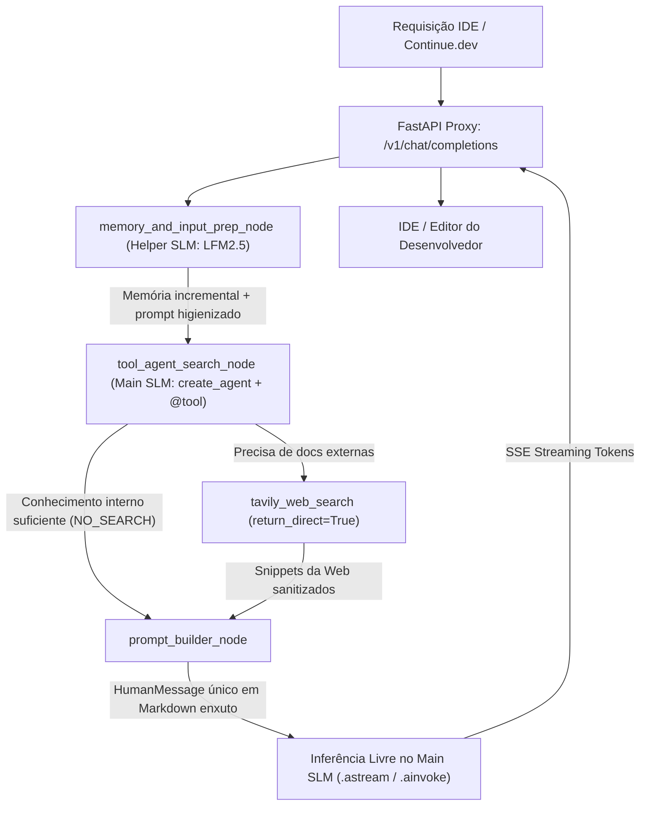

<div align="center">


<br>

# Symphonic AI

## **Orquestração inteligente de modelos de IA em formato de workflow voltado para Small Language Models (SLMs) locais — middleware criado com FastAPI, uvicorn, LangChain e LangGraph**

<p align="center">
<br>


<br>

<br>
</p>

</div>

## 📌 Sumário

- [Visão Geral](#-visão-geral)
- [Principais Funcionalidades](#-principais-funcionalidades)
- [Arquitetura e Fluxo do Workflow](#-arquitetura-e-fluxo-do-workflow)
- [Modelos Especializados (Modelfiles)](#-modelos-especializados-modelfiles)
- [Modelos Validados e em Testes Contínuos](#-modelos-validados-e-em-testes-contínuos)
- [Tabela de Tecnologias e Dependências](#-tabela-de-tecnologias-e-dependências)
- [Pré-requisitos e Variáveis de Ambiente](#-pré-requisitos-e-variáveis-de-ambiente)
- [Guia Rápido de Instalação e Execução](#-guia-rápido-de-instalação-e-execução)
- [Integração com o Continue.dev](#-integração-com-o-continuedev)
- [Testes e Garantia de Qualidade](#-testes-e-garantia-de-qualidade)
- [Licença](#-licença)

---

## 🚀 Visão Geral

O **Symphonic AI** é um orquestrador de modelos de IA em formato de workflow projetado especificamente para **Small Language Models (SLMs)** locais. Construído como um middleware de proxy reverso em **FastAPI** e **LangGraph**, ele coordena múltiplos modelos compactos em harmonia para atuar como ponte inteligente entre assistentes, visando otimizar tarefas e trazer uma maior customização das respostas e do comportamento dos agentes.

Ao utilizar SLMs locais (faixa de 1B a 4B parâmetros) um único modelo isolado sofre com a saturação rápida da janela de contexto e com a falta de acesso a documentações recentes na web. O **Symphonic AI** resolve esses gargalos orquestrando responsabilidades distintas em um fluxo coordenado (**arquitetura Dual-Model v0.5.0**):

1. **Helper SLM — Compressão Direta de Memória (`liquid/lfm2.5-1.7b` / `lfm2.5-helper` recomendado)**: Resume incrementalmente as mensagens anteriores com prompt isolado gerando até 3 bullets pointsem terceira pessoa e preservando tokens da janela de contexto.
2. **Main SLM — Tool Calling Nativo (`qwen/qwen3-1.7b` / `qwen3-main` recomendado)**: Atua como agente autônomo, que contém a sua disposição diverdas ferramentas personalizadas, como o acionamento de busca na web com o [Tavily Search API](https://tavily.com/), possibilidade de leitura e gravação de arquivos em ambiente dedicado e sandbox e entre outros que ainda estão por vir!
3. **Inferência Livre com Streaming SSE**: O prompt final consolidado é montado em um único e otimizado prompt estruturado, e respondido pelo Main SLM no endpoint `/v1/chat/completions` compatível com a API da OpenAI.

> [!NOTE]
> Os estudos empíricos de comportamento, latência e calibração de parâmetros dos SLMs avaliados estão documentados em [docs/study\_validation\_workflow\_for\_slms.md](https://www.google.com/search?q=docs/study_validation_workflow_for_slms.md).

---

## ✨ Principais Funcionalidades

- **Compatibilidade OpenAI `/v1`**: Atua como substituto transparente para qualquer cliente compatível com a especificação da OpenAI (endpoint `POST /v1/chat/completions` com CORS habilitado).
- **Streaming SSE em Tempo Real**: Repasse contínuo de tokens gerados via `main_llm.astream()` para resposta imediata em interfaces que exigem respostas via SSE Stream (ou `ainvoke()` quando `stream=False`).
- **Memória Incremental Sem Overhead de Schema**: O `helper_llm` comprime históricos acima de 3 mensagens diretamente em `SESSION_MEMORY`, evitando falhas de structured output em modelos compactos.
- **Roteamento Inteligente com `create_agent` + `@tool`**: O `main_tool_agent` decide autonomamente entre chamar ferramentas ou simplesmente dar uma resposta direta, assumindo um fluxo de loop com elas para aprimorar ainda mais as respostas e dar mais contexto para elas durante suas ações.
- **Higienização Sintática de Prompts e Respostas**: Funções `sanitize_text_single_newline`, `sanitize_user_prompt` e `sanitize_raw_tavily_snippet` removem tags `<think>...</think>`, caracteres invisíveis e quebras de linha excessivas.
- **6 Modelfiles Especializados**: Receitas prontas em `modelfiles_src/` para funções Main, Helper, Chat Técnico e Autocomplete FIM, mantendo hiperparâmetros e `SYSTEM` prompts nativos no servidor de inferência.
- **Esteira Automatizada de CI/CD**: Execução de testes com Pytest + Coverage.py (`ci.yml`) e publicação automatizada de releases (`cd.yml`) via GitHub Actions, garantindo deploys e conferência de qualidade no mais alto padrão de desenvolvimento!

---

## 🏗️ Arquitetura e Fluxo do Workflow

O fluxo de processamento de cada requisição é governado por uma máquina de estados baseada no **LangGraph** (`AgentState`), estruturada em três nós encadeados antes do streaming final:



### Detalhamento dos Nós do Grafo

1. **`memory_and_input_prep` (`memory_and_input_prep_node`)**:
   Lê o histórico da sessão; quando há mais de 3 mensagens, aciona o `helper_llm` via `.invoke()` direto para integrar novos turnos ao resumo técnico em `SESSION_MEMORY` (máx. 3 bullets em terceira pessoa) e higieniza o pedido atual do usuário preservando indentações e outras propriedades sintáticas estritas.
2. **`tool_agent_search` (`tool_agent_search_node`)**:
   Aciona o `main_tool_agent` (`create_agent` vinculado ao `main_llm` e à ferramenta `tavily_web_search`). Aqui, o modelo decide autonomamente se busca documentação externa via Tavily ou se retorna `NO_SEARCH`, além de verficar em outras etapas deste nó se outras tools são necessárias.
3. **`prompt_builder` (`prompt_builder_node`)**:
   Invoca `assemble_final_prompt()` para montar um único `HumanMessage` enxuto (sem `SystemMessage` em runtime ou outros parâmetros forçados de inferência), estruturado nas seções `# CONTEXT RULES`, `# PRIOR SESSION SUMMARY`, `# EXTERNAL TECHNICAL REFERENCE` e `# CURRENT USER REQUEST`, despachando para o `main_llm.astream()` no FastAPI + Uvicorn.

---

## 🧠 Modelos Especializados (Modelfiles)

O diretório `modelfiles_src/` disponibiliza 6 receitas customizadas de **Modelfile** para o [Ollama](https://ollama.com/), separadas por papel no workflow:

| Modelfile                          | Base / Origem                      | Papel no Workflow                                            | Hiperparâmetros Chave                                                                                |
| :--------------------------------- | :--------------------------------- | :----------------------------------------------------------- | :--------------------------------------------------------------------------------------------------- |
| **`Modelfile_qwen_3_main`**        | `qwen3:1.7b`                       | **Main Role** — Engenheiro Sênior & Tool Agent               | `temperature: 0.3`, `top_k: 30`, `top_p: 0.90`, `min_p: 0.05`, `num_ctx: 4096`                       |
| **`Modelfile_lfm_2_5_helper`**     | `LFM2.5-1.2B-Instruct-Q4_K_M.gguf` | **Helper Role** — Compressor de Memória em 3ª pessoa         | `temperature: 0.2`, `top_k: 20`, `top_p: 0.85`, `min_p: 0.05`, `num_ctx: 4096`                       |
| **`Modelfile_gemma_2_main`**       | `gemma2:2b`                        | **Main Role** — Engenheiro Sênior & Tool Agent               | `temperature: 0.3`, `top_k: 30`, `top_p: 0.90`, `min_p: 0.05`, `num_ctx: 4096`                       |
| **`Modelfile_ministral_main`**     | `ministral:3b`                     | **Main Role** — Engenheiro Sênior & Tool Agent               | `temperature: 0.3`, `top_k: 30`, `top_p: 0.90`, `min_p: 0.05`, `num_ctx: 4096`                       |
| **`Modelfile_qwen2_5_coder`**      | `qwen2.5:1.5b`                     | Chat técnico e engenharia de backend (C, C++, Python, Shell) | `temperature: 0.2`, `top_p: 0.9`, `num_ctx: 4096`, `num_predict: 1024`                               |
| **`Modelfile_qwen2_5_coder_auto`** | `qwen2.5:1.5b`                     | Autocomplete ultrarrápido Fill-In-The-Middle (FIM) para IDEs | `temperature: 0.05`, `num_ctx: 1024`, `num_predict: 128`, `stop: <\|fim_prefix\|>, <\|fim_suffix\|>` |

### Criando os Modelos no Ollama

Para registrar os modelos principais, auxiliares e de autocomplete no seu ambiente local, execute:

```bash
# Modelos da arquitetura Dual-Model v0.5.0
ollama create qwen3-main -f modelfiles_src/Modelfile_qwen_3_main
ollama create lfm2.5-helper -f modelfiles_src/Modelfile_lfm_2_5_helper

# Alternativas para Main Role
ollama create gemma2-2b-main -f modelfiles_src/Modelfile_gemma_2_main
ollama create ministral-3b-main -f modelfiles_src/Modelfile_ministral_main

# Chat técnico e Autocomplete FIM
ollama create qwen2.5-coder-custom -f modelfiles_src/Modelfile_qwen2_5_coder
ollama create qwen2.5-coder-auto -f modelfiles_src/Modelfile_qwen2_5_coder_auto
```

> [!TIP]
> Os parâmetros de inferência (`temperature`, `top_k`, `top_p`, `min_p`, `num_ctx`) e o prompt `SYSTEM` são definidos diretamente no `Modelfile` do Ollama ou nas configurações do LM Studio, evitando sobrescritas conflitantes na camada Python.

---

## 🔬 Modelos Validados e em Testes Contínuos

Abaixo estão relacionados os modelos open-source já submetidos aos benchmarks e testes de estresse do workflow (avaliando latência em streaming, fidelidade de contexto, chamada de ferramentas e custo de inferência local):

| Mantenedor                                                                                                                                                                                   | Modelo                          | Model Card & Paper Original                                                                                                           | Versão Quantizada (GGUF)                                                                                            | Resultado & Recomendação                                                               |
| :------------------------------------------------------------------------------------------------------------------------------------------------------------------------------------------- | :------------------------------ | :------------------------------------------------------------------------------------------------------------------------------------ | :------------------------------------------------------------------------------------------------------------------ | :------------------------------------------------------------------------------------- |
|  **Google DeepMind**                                                                       | **Gemma 4 (e4b / e2b)**         | [Model Card (HF)](https://huggingface.co/google/gemma-4-E4B) • [Gemma Paper](https://arxiv.org/abs/2607.02770)                        | [Gemma GGUF Collections](https://huggingface.co/collections/google/googles-gemma-models-family)                     | ✅ Testado • ⭐ **Recomendado (Main SLM)**                                               |
|  **Alibaba Cloud (Qwen)**                               | **Qwen3-1.7B**                  | [Model Card (HF)](https://huggingface.co/Qwen/Qwen3-1.7B) • [QwenLM Blog](https://qwenlm.github.io/)                                  | [Qwen3-1.7B-GGUF](https://huggingface.co/Qwen/Qwen3-1.7B-GGUF)                                                      | ✅ Testado • ⭐ **Recomendado (Main SLM)**                                               |
|  **Mistral AI**                                                                            | **Ministral 3 3B**              | [Model Card (HF)](https://huggingface.co/mistralai/Ministral-3B-Instruct) • [Mistral Docs](https://docs.mistral.ai/)                  | [Ministral-3B-GGUF](https://www.google.com/search?q=https://huggingface.co/models%3Fsearch%3DMinistral%2B3B%2BGGUF) | ✅ Testado • ⭐ **Recomendado (Main SLM)**                                               |
|  **Liquid AI** | **Liquid LFM2.5 1.7B (LFM2.5)** | [Liquid AI Hub](https://huggingface.co/LiquidAI) • [Liquid Docs](https://www.liquid.ai/)                                              | [LFM2.5-GGUF](https://huggingface.co/LiquidAI/LFM2.5-1.2B-Thinking-GGUF)                                            | ✅ Testado • ⭐ **Recomendado (Helper SLM)**                                             |
|  **Alibaba Cloud (Qwen)**                               | **Qwen2.5-Coder-3B**            | [Model Card (HF)](https://huggingface.co/Qwen/Qwen2.5-Coder-3B-Instruct) • [Qwen2.5-Coder Report](https://arxiv.org/abs/2409.12186)   | [Qwen2.5-Coder-3B-GGUF](https://huggingface.co/Qwen/Qwen2.5-Coder-3B-Instruct-GGUF)                                 | ✅ Testado com sucesso                                                                  |
|  **Alibaba Cloud (Qwen)**                               | **Qwen2.5-Coder-1.5B**          | [Model Card (HF)](https://huggingface.co/Qwen/Qwen2.5-Coder-1.5B-Instruct) • [Qwen2.5-Coder Report](https://arxiv.org/abs/2409.12186) | [Qwen2.5-Coder-1.5B-GGUF](https://huggingface.co/Qwen/Qwen2.5-Coder-1.5B-Instruct-GGUF)                             | ✅ Testado com sucesso (Autocomplete FIM & Chat)                                        |
|  **Alibaba Cloud (Qwen)**                               | **Qwen2.5-0.8B (0.5B)**         | [Model Card (HF)](https://huggingface.co/Qwen/Qwen2.5-0.5B-Instruct) • [Qwen2.5 Paper](https://arxiv.org/abs/2412.15115)              | [Qwen2.5-0.5B-GGUF](https://huggingface.co/Qwen/Qwen2.5-0.5B-Instruct-GGUF)                                         | ✅ Testado com sucesso (Avaliação ultraleve)                                            |
|  **Meta AI**                                    | **Llama 3.2 1B Instruct**       | [Model Card (HF)](https://huggingface.co/meta-llama/Llama-3.2-1B-Instruct) • [Llama 3 Paper](https://arxiv.org/abs/2407.21783)        | [Llama-3.2-1B-GGUF](https://huggingface.co/bartowski/Llama-3.2-1B-Instruct-GGUF)                                    | ✅ Testado com sucesso                                                                  |
|  **Google DeepMind**                                                                       | **Gemma 2 1B IT QAT**           | [Model Card (HF)](https://huggingface.co/google/gemma-2-2b-it) • [Gemma 2 Report](https://arxiv.org/abs/2408.00118)                   | [Gemma-2-GGUF](https://huggingface.co/google/gemma-2-2b-it-GGUF)                                                    | ✅ Testado com sucesso (QAT)                                                            |
|  **Hugging Face**                                                                    | **SmolLM2-1.7B Instruct**       | [Model Card (HF)](https://huggingface.co/HuggingFaceTB/SmolLM2-1.7B-Instruct) • [SmolLM2 Blog](https://huggingface.co/blog/smollm)    | [SmolLM2-1.7B-GGUF](https://huggingface.co/bartowski/SmolLM2-1.7B-Instruct-GGUF)                                    | ❌ Testado — Não passou na maior parte dos testes e foi descartado como opção principal |

---

## 📊 Tabela de Tecnologias e Dependências

O projeto utiliza o ecossistema moderno de orquestração de IA em Python (`pyproject.toml` e `requirements.txt`):

| Pacote / Ferramenta   | Versão Mínima      | Função no Projeto                                                       |
| :-------------------- | :----------------- | :---------------------------------------------------------------------- |
| **Python**            | `>= 3.10`          | Ambiente base de execução (CI configurado em Python 3.12)               |
| **FastAPI**           | `>= 0.115.0`       | Servidor HTTP assíncrono para o proxy reverso                           |
| **Uvicorn**           | `>= 0.30.0`        | Servidor ASGI de alta performance (`uvicorn[standard]`)                 |
| **LangGraph**         | `>= 0.2.30`        | Grafo de estados para orquestração modular de agentes                   |
| **LangChain & Core**  | `>= 0.3.0`         | `create_agent`, `@tool`, abstrações de mensagens e prompts              |
| **LangChain OpenAI**  | `>= 0.2.0`         | Cliente para comunicação com endpoints locais OpenAI-compatible         |
| **Tavily Python**     | `>= 0.5.0`         | SDK de busca e recuperação de conteúdo na web para RAG                  |
| **Pydantic**          | `>= 2.9.0`         | Validação de payloads da API OpenAI (`ChatCompletionRequest`) e schemas |
| **Python-Dotenv**     | `>= 1.0.0`         | Carregamento automático de variáveis de ambiente via `.env`             |
| **Pytest & Coverage** | `>= 8.3.0 / 5.0.0` | Testes unitários assíncronos (`pytest-asyncio`, `httpx`) e cobertura    |

---

## ⚙️ Pré-requisitos e Variáveis de Ambiente

### Pré-requisitos

- **Python 3.10 ou superior** instalado.
- Servidor de inferência local ativo:
  - **[Ollama](https://ollama.com/)** (porta padrão `11434`) ou **[LM Studio](https://lmstudio.ai/)** (porta padrão `1234`).
- Chave de API da **[Tavily](https://tavily.com/)** (caso deseje habilitar a pesquisa automática na web).

### Configuração do Arquivo `.env`

Crie um arquivo `.env` na raiz do projeto com base nas seguintes variáveis lidas pelo `src/workflow_ai_orquestration.py`:

```env
# Chave da API Tavily para pesquisas dinâmicas na web
TAVILY_API_KEY="tvly-sua-chave-de-api-aqui"

# URL do servidor de inferência local (Ollama ou LM Studio)
LOCAL_LLM_BASE_URL="http://localhost:1234/v1"
LOCAL_LLM_API_KEY="not-needed"

# Identificadores dos modelos recomendados no pipeline Dual-Model (v0.5.0)
MAIN_MODEL_NAME="qwen/qwen3-1.7b"
HELPER_MODEL_NAME="liquid/lfm2.5-1.7b"
```

---

## 🛠️ Guia Rápido de Instalação e Execução

### 1. Clonar o Repositório

```bash
git clone https://github.com/Symphonic-AI/symphonic_orquestrator.git
cd symphonic_orquestrator
```

### 2. Criar e Ativar o Ambiente Virtual

```bash
# Cria o ambiente virtual
python3 -m venv .venv

# Ativa no Linux / macOS
source .venv/bin/activate

# Ou ativa no Windows (PowerShell)
# .venv\Scripts\Activate.ps1
```

### 3. Instalar as Dependências

```bash
pip install --upgrade pip
pip install -r requirements.txt
```

_(Opcional para desenvolvimento via `pyproject.toml`: `pip install -e ".[dev]"`)_

### 4. Iniciar o Servidor Proxy

Inicie o servidor diretamente ou via Uvicorn com recarregamento automático:

```bash
# Execução direta (porta padrão 8000 em 127.0.0.1)
python src/orquestrator.py

# Ou via Uvicorn para desenvolvimento
uvicorn src.orquestrator:app --host 127.0.0.1 --port 8000 --reload
```

O proxy estará acessível em `http://127.0.0.1:8000/v1/chat/completions`.

---

## 🔌 Integração com o Continue.dev

Para conectar a extensão [Continue.dev](https://continue.dev/) no VS Code ou JetBrains ao proxy local, adicione o modelo ao arquivo de configuração `~/.continue/config.json`:

```json
{
  "models": [
    {
      "title": "Symphonic AI",
      "provider": "openai",
      "model": "qwen/qwen3-1.7b",
      "apiBase": "http://localhost:8000/v1",
      "apiKey": "no-needed"
    }
  ],
  "tabAutocompleteModel": {
    "title": "Qwen 2.5 Coder Autocomplete",
    "provider": "ollama",
    "model": "qwen2.5-coder-auto",
    "apiBase": "http://localhost:11434"
  }
}
```

---

## 🧪 Testes e Garantia de Qualidade

A suíte de testes unitários em `tests/units/` valida os nós do LangGraph, a normalização de conteúdo e os endpoints FastAPI, com esteira configurada em `.github/workflows/ci.yml`:

```bash
# Executa a suíte de testes unitários
pytest tests/units/test_general_workflow.py

# Executa testes gerando relatório de cobertura
pytest tests/units/test_general_workflow.py --cov=server --cov-report=term-missing
```

---

## 📄 Licença

Este projeto está distribuído sob a licença **GPL 3.0**. Consulte o arquivo [LICENSE](./LICENSE) para mais informações.